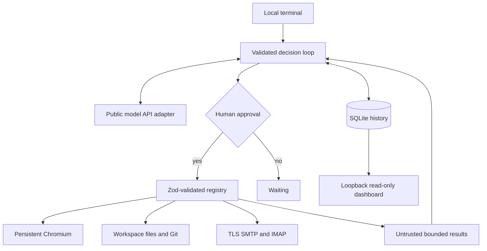

<p align="center"></p>

<p align="center"><b>A TypeScript personal-assistant workspace you run and review yourself.</b><br>Natural-language tasks, persistent progress and tools you control.</p>
<p align="center">  </p>

## Workspace map

```text
personal-agent-starter/
├── src/
│   ├── index.ts                 # CLI and exact-call approval
│   ├── server.ts                # Read-only loopback dashboard
│   ├── agent/loop.ts            # Decision loop and state transitions
│   ├── models/router.ts         # Four provider adapters
│   ├── memory/db.ts             # SQLite task/session/event history
│   └── tools/
│       ├── browser.ts           # Persistent sessions and manual MFA
│       ├── email.ts             # TLS SMTP and IMAP verification lookup
│       ├── fileManager.ts       # Chunk reads and exact-match patches
│       ├── git.ts               # Reviewed Git workflow and LFS
│       └── registry.ts          # Validated plugin seam
├── test/                        # Unit tests and local Chromium/Git tests
├── scripts/                     # Setup wizard and doctor
├── docs/SECURITY.md
├── assets/banner.svg
├── .github/workflows/ci.yml
├── .env.example
├── .gitignore
├── .dockerignore
├── Dockerfile
├── package.json
├── package-lock.json
└── tsconfig.json
```

## Capabilities

| Area | Included |
| --- | --- |
| Agent | Persisted plan/reflection decisions, human approval, 25-step budget, explicit resume |
| Recall | Explicit non-secret notes with SQLite FTS5 ranked search and deletion |
| Models | Anthropic, OpenAI, OpenRouter and Ollama over public HTTP APIs |
| Persistence | SQLite sessions, goals, states, approved calls, ordinary outputs and errors |
| Browser | Persistent profiles, origin allowlist, 1.5-second action spacing, forms, clicks, Markdown, screenshots |
| Login | Local env or manual login, CAPTCHA/2FA pause, explicit success selector, auth snapshots |
| Email | TLS SMTP; exact sender/subject/time-filtered IMAP lookup, latest 10 matches |
| Files | Workspace-confined paths, 500-line chunks, create without overwrite, exact-match patch |
| Git | Init, branch, status, explicit-file Conventional Commits, GitHub push, optional Git LFS |
| Developer UX | Setup wizard, doctor, read-only neon dashboard, Dockerfile and CI definition |

This is a supervised developer starter, not an unattended production service. No product-parity claim is made. Only connect accounts after reading [Security](docs/SECURITY.md).

## Prerequisites

- Node.js **22.13+**, npm and Git. Node 22's experimental SQLite warning is expected.
- Git LFS only if you want large-file tracking.
- A graphical desktop for interactive login/2FA. A headless server needs its own display setup; no remote desktop is bundled.
- A running local Ollama with a downloaded model, or your own model API key. Cloud models can cost money.
- Optional IMAP/SMTP account. Some providers require app passwords. Gmail OAuth is not implemented.

## Quickstart

```bash
git clone https://github.com/instinctsetup/personal-agent-starter.git
cd personal-agent-starter
npm ci
npm run setup
# Edit .env locally if you need an API key. Never put secrets in a task.
npx playwright install chromium
npm run build
npm test
npm run doctor
npm start -- run "Create hello.txt with a friendly greeting"
```

The wizard asks only for provider/model, writes `.env` privately and never overwrites it. On Windows, check file permissions yourself. For local Ollama, install/start it following its official docs and run `ollama pull llama3.2`. The small default model is for demos, not a guarantee of reliable planning.

Every tool call prints its exact arguments. Type **yes** to approve that call; anything else pauses. Check targets, recipients, file content and consequences. The model cannot approve itself.

## Environment configuration

| Variable | Purpose |
| --- | --- |
| `MODEL_PROVIDER` | `ollama`, `openai`, `openrouter`, `anthropic` |
| `MODEL_NAME` | Exact provider model identifier |
| `MODEL_API_KEY` | Cloud key, blank for local Ollama |
| `MODEL_BASE_URL` | Optional endpoint override, without operation path |
| `WORKSPACE_ROOT` | File/Git root, default `./workspace` |
| `AGENT_DB` | SQLite path, default `./agent_memory.db` |
| `BROWSER_HEADLESS` | `false` for interactive login |
| `BROWSER_ALLOWED_ORIGINS` | Exact scheme/host/port entries separated by commas; no paths |
| `SITE_USER`, `SITE_PASSWORD` | Optional credentials used only by local login helper |
| `SMTP_*`, `MAIL_FROM` | Outgoing mail connection and sender |
| `IMAP_*` | Incoming mail connection, TLS port 993 by default |

Default endpoints: OpenAI `https://api.openai.com/v1`, OpenRouter `https://openrouter.ai/api/v1`, Anthropic `https://api.anthropic.com/v1`, Ollama `http://127.0.0.1:11434`. Choose your own available model name. A remote provider receives goals and ordinary tool/page outputs. Use local Ollama for private tasks if appropriate.

## Commands and persistence

```bash
npm start -- run "Read lines 1 to 80 of src/main.ts and suggest a fix"
npm start -- status
npm start -- status TASK_ID
npm start -- resume TASK_ID
npm start -- login https://example.com/login '#account-menu'
npm start -- serve
# Read-only dashboard: http://127.0.0.1:8787
```

Save the printed task UUID. Restarted `running` tasks become `waiting`. Completed tasks cannot resume. A denied action or step budget also pauses. Resume reasons from stored history instead of automatically replaying uncertain writes. Verify external state before approving a repeated action. Ctrl+C stops after the current operation, not mid-submit. Use one process per database/profile.

## Login, cookies and 2FA

1. Add only trusted exact origins, including necessary sign-in redirect origins, to the allowlist.
2. Set `BROWSER_HEADLESS=false`; run `login URL SUCCESS_SELECTOR`. Choose a selector visible only when signed in.
3. Complete login in Chromium. Optional env credentials fill default email/password selectors. Custom selectors are available through `login_to_site` in a task or direct code.
4. Complete CAPTCHA, OTP, authenticator or push approval manually. Press Enter in the terminal after completing it.
5. The success selector must appear within 120 seconds before state is saved.
6. Close normally. `.browser_profiles/default/` persists the full profile across runs.

An active headless session cannot hot-switch to headful; restart first. `save_storage_state` exports cookies/localStorage and supported IndexedDB state to `playwright/.auth/state.json`. `load_storage_state` restores cookies and per-origin localStorage, **not IndexedDB/sessionStorage**. Prefer the persistent profile for complex sites. Auth snapshots grant account access. Never commit or share them.

### LinkedIn and other logged-in sites

Generic browser tools can open allowed authenticated sites, but this is not a LinkedIn-specific integration. Sites can restrict automation, flag sessions or suspend accounts. The 1.5-second action spacing is only a basic throttle, not a safe-use guarantee. Prefer official APIs/manual use; stop on challenges or throttling. No stealth, anti-detection or CAPTCHA-bypass features are included.

## Email

Set credentials locally. `mail_verification` takes exact sender, case-sensitive subject fragment and ISO start time, then privately displays matching codes/links. Results never enter model history; links are not auto-opened and OTPs are not auto-filled. Numeric matches may be unrelated numbers. Sender matching is not authentication. Inspect message/link identity yourself.

`mail_send` requires review of the exact recipient, subject and text. No bulk or scheduled sending is included. The IMAP/SMTP adapter supports basic/app-password authentication, not Gmail OAuth. Use the provider's current account instructions.

## Git and files

Tools act under `WORKSPACE_ROOT`, not this project's source tree by default. Initialize with `git_init`, create a branch, edit/read files, inspect `git_status`, then approve a commit with explicit files and a message such as `feat: add greeting`. A nonempty staging index is rejected so unrelated changes cannot silently join a commit.

Configure Git identity, repository origin and credentials locally before pushing. Use your existing SSH agent, OS credential helper or interactive `gh auth login`. For PAT authentication use the helper's secure prompt. Never embed a PAT in a remote URL, task, source file or command argument. GitHub push uses the existing credential setup and permits only credential-free GitHub remotes.

Install Git LFS separately if needed. `git_lfs` initializes local LFS and tracks a pattern such as `*.psd`; review and commit `.gitattributes`. Check hosting quota before pushing large objects. Ignore rules cannot remove secrets already tracked; audit the index before any push.

## Architecture and plugins



The loop emits `step`, `result` and `private-result`. The plugin seam is `registry.ts`: a tool has a description, Zod schema, async handler and optional `persistOutput: false`. Plugins are not dynamically downloaded.

```ts
tools.word_count = {
  description: 'Count words in {text}.',
  schema: z.object({text: z.string().max(10000)}).strict(),
  run: async ({text}) => ({count: text.trim() ? text.trim().split(/\s+/).length : 0})
};
```

All plugins still need review. Schemas validate shapes, not whether a request is authorized. Never let external text authorize tools. Avoid arbitrary shell plugins and unsupervised outbound communication without separate controls/tests.

## Tests and CI

```bash
npm run build
npm test
npm audit --omit=dev
```

The suite covers persistence, chunk edits/path checks, approvals, denied actions, invalid model JSON, budgets, sensitive result handling, four mocked provider protocols, local dashboard, real local Git and real Chromium forms/state/screenshot fixtures. Install Chromium before testing. On Linux, `npx playwright install --with-deps chromium` can install missing OS libraries with appropriate permissions.

Live model keys, real inboxes, real-site MFA and remote Git pushes are **not** end-to-end tested. Docker deployment is not verified. CI is defined; its presence does not claim a passing hosted run.

## Docker

```bash
docker build -t personal-agent-starter .
docker run --rm -it --env-file .env personal-agent-starter npm start -- status
```

The image includes Chromium and runs as non-root. Default command only shows status. Container data is ephemeral unless you mount private volumes for database/workspace/profile/auth state. Headful login requires your separately managed display; no VNC/Xvfb is supplied. The dashboard binds loopback and is intentionally not exposed. Docker config is provided, not deployment-tested.

## Troubleshooting

| Problem | Fix/check |
| --- | --- |
| SQLite experimental warning | Expected on Node 22; use 22.13+ |
| Browser executable missing | `npx playwright install chromium` |
| Linux libraries missing | Install Playwright OS dependencies |
| Headless login fails | Restart headful |
| Origin blocked | Allow only the trusted exact origin and restart |
| Invalid model JSON | Choose a model with reliable JSON output, inspect status, resume deliberately |
| HTTP 401/403/404 | Check provider/key/model/base URL |
| No verification email | Check sender, subject case, timestamp, credentials and inbox |
| Git push denied | Check remote, permissions, auth and branch protection |
| Patch mismatch | Reread current lines and supply exact expected text |
| Port 8787 busy | Close the other process |
| Setup refuses overwrite | Preserve/edit the existing `.env` locally |

`npm run doctor` checks local prerequisites without inspecting secret values.

## Explicit memory and reasoning

The model can emit a `plan` decision with up to 12 steps or a `reflect` decision containing an observation and next step. These are stored and shown in the terminal. They do not execute actions, count toward the same step budget, and do not prove the plan is correct.

`memory_remember` saves only a note you approve; `memory_recall` searches those notes using SQLite FTS5 (up to 8 ranked results); `memory_forget` deletes a note by UUID. This is keyword recall, not vector memory. Notes are plaintext and may enter the configured model when recalled. Do not save secrets. Nothing automatically copies browser/email content into long-term notes.

## Deliberate limits

No autonomous daemon, cron scheduler, bot hooks, webhook receiver, vector memory, encrypted vault, distributed queue, automatic side-effect retries, mobile notifications or multi-user dashboard. These need their own security/reliability work. `.env` is not an encrypted vault; SQLite history is not semantic memory. File checks are guardrails, not an OS sandbox. The browser allowlist is not a network firewall. See the security document for the full boundaries.

Okay, here's something more like project content than credits, a short "Why this exists" section:

A) Why this exists: Most AI agents either run unattended or are hard to trust. This starter keeps you in control: it plans a task, shows every action before it runs, and remembers progress between sessions. Meant for learning how agents work and as a base to extend.

B) Roadmap: scheduled jobs, chat bot hooks (Telegram/Slack), vector memory, an encrypted credential vault, more browser tools. Contributions welcome.

C) Motivation: Built to explore how a personal agent can automate browsing, email and code while a human stays in the loop.

