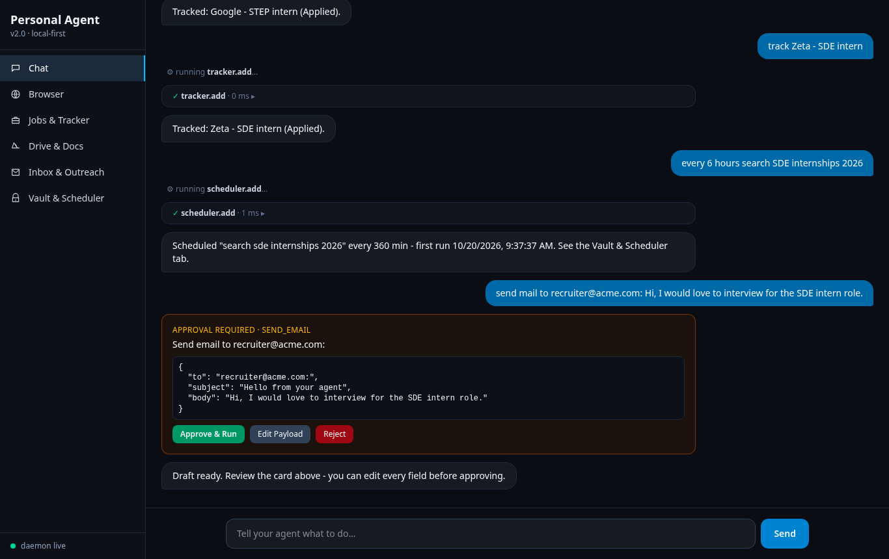
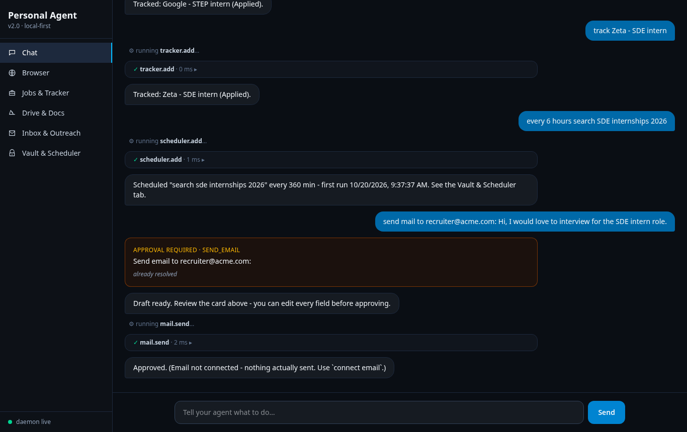
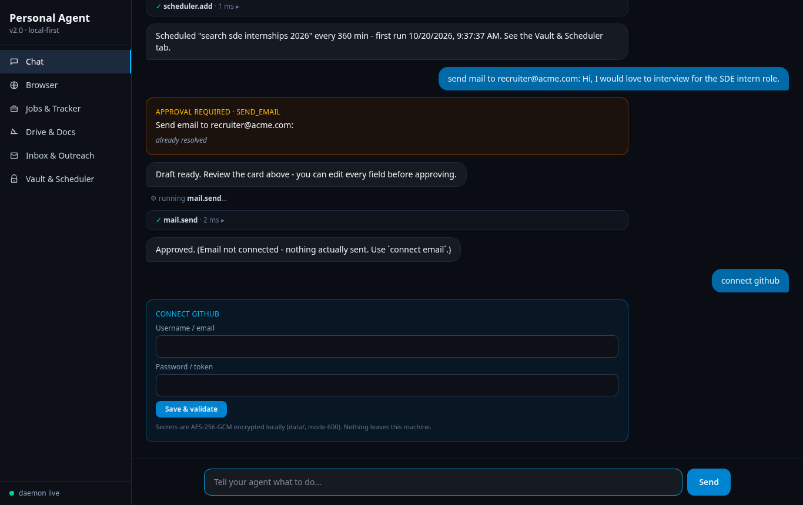
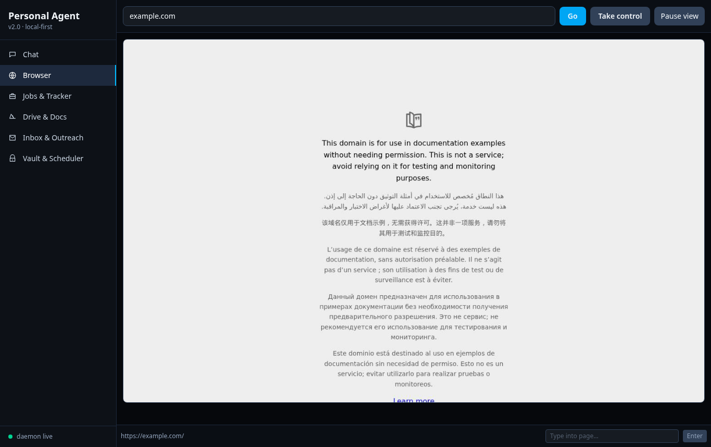
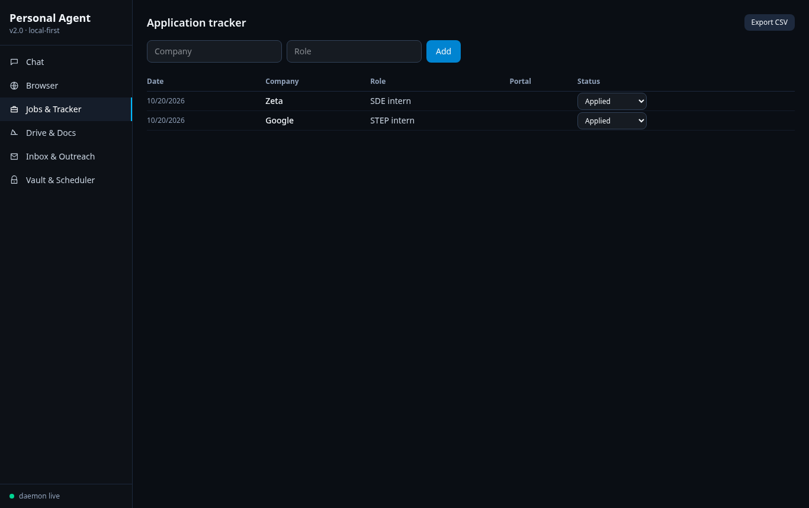
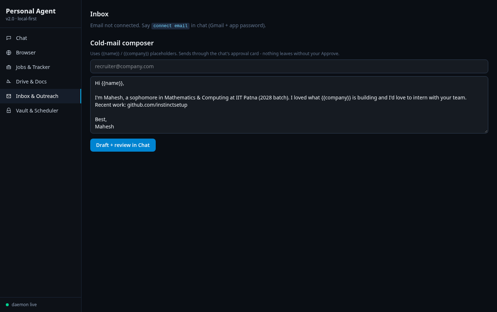
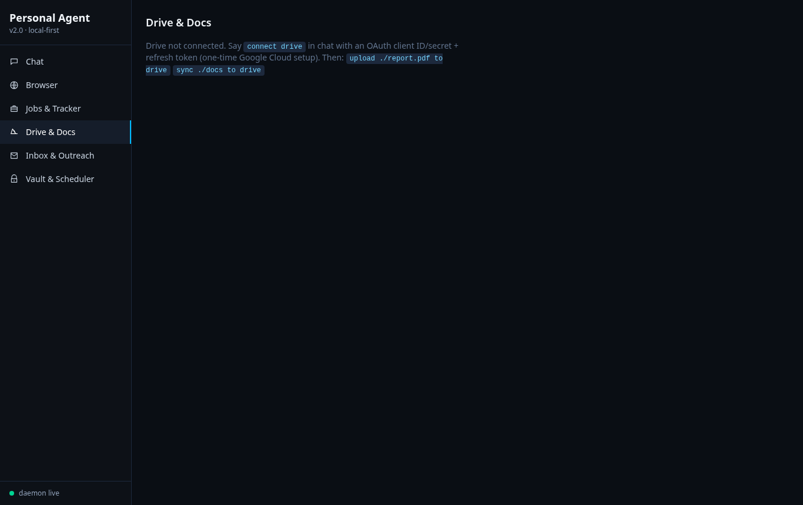
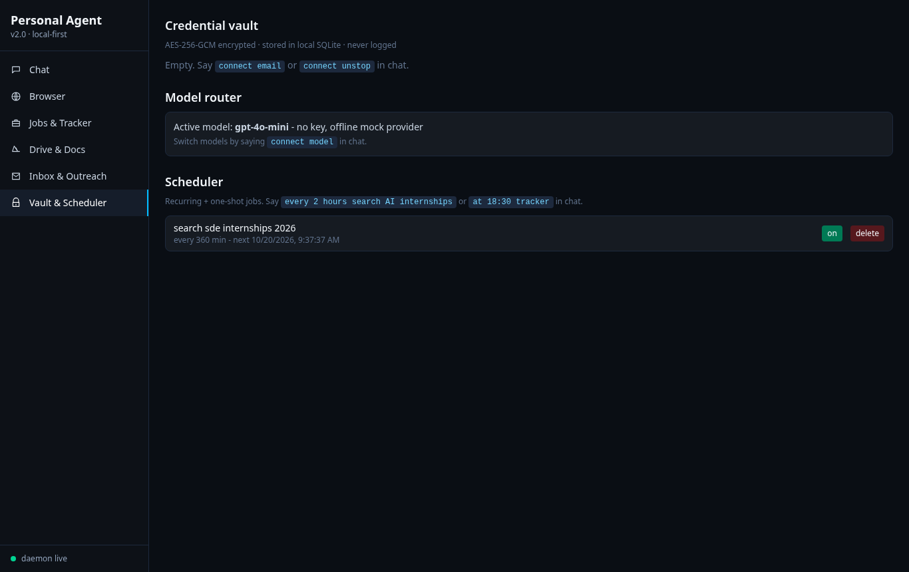

# Personal Agent v2.0 — The Complete Guide

**A local-first personal agent for internship hunting, email, signups, scheduling, and web automation — with a human in the loop for everything that matters.**

Version 2.0 · October 2026 · github.com/instinctsetup/personal-agent-starter

---

<div style="page-break-before: always"></div>

## Table of contents

1. What this is (and what it is not)
2. Architecture at a glance
3. Installation and first run
4. The Chat tab: your command center
5. Human-in-the-loop approvals
6. Setup cards: connecting services safely
7. The Browser tab: a live, shared browser
8. The signup engine
9. Jobs: the universal applier and the tracker
10. Web search without API keys
11. Inbox and cold outreach
12. Drive and Docs sync
13. Vault and model router
14. The scheduler
15. The git engine
16. Telegram and Slack bridges
17. LinkedIn assist
18. Security model
19. Testing
20. Honest limits and troubleshooting
21. Command reference

<div style="page-break-before: always"></div>

## 1. What this is (and what it is not)

Personal Agent v2.0 is a **self-hosted web application** that runs entirely on your own machine. You open a browser tab, chat with your agent in plain English, and it does real work: searching the web, driving a browser you can watch and take over, signing up on sites, filling job applications, sending email after you approve it, scheduling recurring tasks, syncing files to Google Drive, and committing code.

It is **local-first**: the database, the vault, the browser profile, and every log line live under `./data/` on your disk. Nothing is sent anywhere except the services you explicitly connect.

It is **human-in-the-loop**: any action that touches the outside world — sending an email, submitting an application — pauses on an approval card. You can read the exact payload, edit every field, approve, or reject. The agent never fires a consequential action on its own.

It is **not** a cloud service, not a SaaS, and not an autonomous agent you let loose. It is a power tool with a safety catch.

### Design principles

1. **No fake autonomy.** When something is simulated (email without SMTP configured, search blocked on a datacenter IP), the UI says so, in plain words, next to the result.
2. **Secrets stay sealed.** Credentials are encrypted with AES-256-GCM before they touch disk. The UI lists usernames, never secrets.
3. **No evasion.** The built-in browser is plain Chromium. It does not spoof fingerprints, rotate user agents, or defeat CAPTCHAs. When a wall appears, control passes to you.
4. **Everything is testable.** 79 automated tests cover the vault crypto, OTP extraction, search parsing, approvals, scheduler, git engine, signup engine, drive sync planner, bridges, and more.

<div style="page-break-before: always"></div>

## 2. Architecture at a glance

```
+-------------------------------------------------------------+
|  Browser (React + Vite + Tailwind, dark UI)                 |
|  6 tabs: Chat | Browser | Jobs | Drive | Inbox | Vault      |
+------------------------+-----------------+------------------+
                         |  HTTP + WebSocket
+------------------------v------------------------------------+
|  Fastify daemon (Node.js + TypeScript)                      |
|                                                             |
|  agent core ---- event bus (WS fan-out + SQLite persist)    |
|     |                                                       |
|     +-- approvals queue (15-min expiry)                     |
|     +-- vault (AES-256-GCM)                                 |
|     +-- search (DuckDuckGo -> Bing fallback)                |
|     +-- browser engine (Playwright persistent profile)      |
|     +-- signup engine (Google SSO + OTP assist)             |
|     +-- job applier (profile-facts-only)                    |
|     +-- mail (IMAP read + SMTP send)                        |
|     +-- drive sync (OAuth refresh token, REST)              |
|     +-- git engine (init/commit/push/GitHub API)            |
|     +-- scheduler (30s tick, SQLite-backed)                 |
|     +-- bridges (Telegram long-poll, Slack Events API)      |
+------------------------+-----------------+------------------+
                         |
              SQLite (WAL) under ./data/
              + encrypted vault + browser profile
```

**Stack note.** The v2.0 spec mentioned Next.js. The shipped stack is a Vite + React single-page app served by the Fastify daemon. For a loopback, desktop-style application, server-side rendering and SEO add nothing, and the Vite build is dramatically lighter and faster. The README states this plainly as a deliberate choice.

**Why SQLite in WAL mode.** Write-ahead logging lets the event bus persist every chat event while the API reads history concurrently, without lock contention. The whole database is one file you can back up by copying.

<div style="page-break-before: always"></div>

## 3. Installation and first run

### Requirements

- Node.js 20 or newer
- ~400 MB disk (Chromium download for browser features)
- Linux, macOS, or WSL2

### Steps

```bash
git clone https://github.com/instinctsetup/personal-agent-starter.git
cd personal-agent-starter
git checkout v2
npm install
npx playwright install chromium   # browser features only
npm start
```

`npm start` compiles the daemon, builds the UI, starts the server on `http://127.0.0.1:3090`, and opens your default browser. From here on, **you never need the terminal for daily use** — everything happens in the web UI.

### First five minutes

1. Type `help` in the chat to see every command.
2. Type `connect model` and add an OpenAI-compatible API key for real AI answers (without one, a clearly-labeled offline mock provider replies).
3. Type `connect email` to add a Gmail address + app password for the inbox and sending.
4. Type `connect profile` and fill your name, email, phone, resume path, college, and graduation year — the job applier uses exactly these facts, nothing else.
5. Type `track Google - STEP intern` and open the **Jobs & Tracker** tab.

### Stopping and restarting

The daemon is a foreground process; Ctrl+C stops it. `npm start` again resumes — all state (chat history, tracker, vault, jobs) persists in `./data/`.

<div style="page-break-before: always"></div>

## 4. The Chat tab: your command center

The Chat tab is a live command stream. Your messages appear as blue bubbles on the right. The agent replies on the left, and between them you see **tool cards**: collapsible records of every tool the agent ran, with its inputs, duration, and result.



Every assistant action is visible. When the agent searches the web, you see a `web.search` card. When it schedules a job, a `scheduler.add` card. When it sends mail, a `mail.send` card — after you approve it.

### Kinds of messages

- **Text** — normal conversation and results.
- **Tool cards** — click to expand and see the exact input and output.
- **Approval cards** — amber-bordered, requiring your decision (next chapter).
- **Setup cards** — inline forms for connecting services (chapter 6).

### The event stream

Everything in chat is an event on an internal bus, broadcast over a WebSocket and persisted to SQLite. Reload the page and the full history replays. Open the UI on a second browser and both stay in sync live.

<div style="page-break-before: always"></div>

## 5. Human-in-the-loop approvals

The approval system is the heart of the safety model. Whenever the agent is about to do something consequential — today: sending an email or submitting a job application — it stops and presents an **approval card**.


Each card shows:

- the **action type** (e.g. `SEND_EMAIL`),
- a **human summary** ("Send email to recruiter@acme.com"),
- the **complete payload** as formatted JSON — recipient, subject, body.

Your three options:

- **Approve & Run** — execute exactly what is shown.
- **Edit Payload** — the JSON becomes editable; change any field, then approve. The agent executes your edited version.
- **Reject** — cancel; the agent acknowledges and moves on.

Cards **expire after 15 minutes**; an expired card resolves as `expired` and the action does not run. Resolution is one-shot: a card cannot be approved twice.



Note the honesty in the screenshot above: the user approved, but because no SMTP credentials were configured, the agent says *"Approved. (Email not connected - nothing actually sent.)"* — it never pretends a send happened.

<div style="page-break-before: always"></div>

## 6. Setup cards: connecting services safely

Say `connect <service>` and a **setup card** appears inline in chat: a small form with labeled fields. Secret fields (passwords, tokens) are masked.



Built-in setup cards:

| Card | Fields |
|---|---|
| `connect model` | Base URL (any OpenAI-compatible endpoint), model name, API key |
| `connect email` | IMAP host, SMTP host, email address, app password |
| `connect drive` | OAuth client ID, client secret, refresh token |
| `connect profile` | Full name, email, phone, resume path, college, graduation year |
| `connect github` | Username, personal access token |
| `connect telegram` | Bot token |
| any other service | Generic username + secret, stored in the vault |

Where possible, the agent validates live after saving — for a model connection it sends a one-word ping and reports whether it got a reply.

Secrets go to the **vault** (chapter 13), non-secret settings to the settings table. You can update any card later by saying `connect <service>` again.

<div style="page-break-before: always"></div>

## 7. The Browser tab: a live, shared browser

The Browser tab shows the agent's browser in near-real-time: a screenshot stream refreshed every 1.2 seconds.



You can drive it yourself:

- **URL bar + Go** — navigate.
- **Click anywhere on the screenshot** — the click is coordinate-mapped to the page and executed.
- **Type into page** — sends keystrokes to the focused field, plus an Enter button.

And you can take over:

- **Take control** — flips a flag that tells the agent's automation to pause. Solve the CAPTCHA, complete the 2FA, log in once — then flip it back and tell the agent to continue.
- When the agent detects a CAPTCHA or 2FA wall itself, an amber banner appears prompting exactly this.

### The no-evasion guarantee

The browser is a **plain Chromium** with a persistent profile (`data/browser-profile/`). There is:

- no `--disable-blink-features=AutomationControlled`,
- no custom user agent (Chromium's default),
- no `navigator.webdriver` patching.

Sites see it exactly as an automated browser. That is a deliberate ethical stance: we do not evade anti-bot systems; we hand you control instead. Login sessions you create manually persist between runs — log into LinkedIn once, and the session is there next week.

<div style="page-break-before: always"></div>

## 8. The signup engine

Say `sign up on <site> with google` and the signup engine takes the shared browser through the site's Google-SSO flow:

1. **Navigate** to the site.
2. **Discover** a "Continue with Google" / "Sign up with Google" control (seven selector strategies, visibility-checked).
3. **Click through** the Google flow using your stored Google credential (`connect google`).
4. **Detect walls.** CAPTCHA or 2FA → the agent asks you to take control, waits up to five minutes, and resumes when you're done.
5. **OTP assist.** If the site emails a verification code, say `finish signup <site>` — the engine scans your connected inbox (fresh mail only) with the OTP extractor and fills the code.
6. **Record** the outcome in the `signups` table: site, method, username, status (`completed`, `pending_verification`, `failed`).

Say `signups` any time to list them.

The engine is honest about limits: if no Google-SSO option exists on the page, it says so and shows you what it saw in the Browser tab. It never fabricates a signup.

<div style="page-break-before: always"></div>

## 9. Jobs: the universal applier and the tracker

### The applier

Say `apply to <job-url>`. The applier (battle-tested from v1) opens the posting, finds the application form, and fills it **using only your stored profile facts** — the ones from `connect profile`. It does not invent answers. Questions it cannot answer are collected and reported to you as a missing-facts list instead of being guessed.

Before anything is submitted, you get an **approval card** with a human summary of exactly what will be sent. Approve to submit, reject to cancel. Submitted applications are automatically recorded in the tracker with the portal hostname and URL.

### The tracker



The tracker is a full CRUD board: add applications manually (in the tab or with `track <Company> - <role>`), move them through the pipeline — **Applied → Cold Mailed → Replied**, or **Rejected / Scam Flagged** — attach notes, and export everything as CSV with one click (`/api/tracker.csv`).

Statuses were chosen for internship hunting reality: "Cold Mailed" pairs with the outreach composer (chapter 11), and "Scam Flagged" keeps predatory listings visible in hindsight.

<div style="page-break-before: always"></div>

## 10. Web search without API keys

Say `search <query>`. The agent queries **DuckDuckGo's HTML endpoint** first; if that yields nothing (rate-limited networks return a challenge page), it falls back to **Bing**, decoding Bing's wrapped redirect URLs back to real destinations.

Results come back as a numbered list with title, URL, and snippet, plus an expandable `web.search` tool card.

**Honest limit:** keyless search depends on your IP's reputation. Datacenter IPs are often challenged; residential connections work reliably. The parsers and the fallback chain are unit-tested against real captured pages, so when the network cooperates, the results are real. When it doesn't, the agent says "No results" and the README explains why — it never returns invented links.

### Scheduled searching

Search pairs naturally with the scheduler: `every 6 hours search SDE internships 2026` keeps a standing query running and posts fresh results into your chat.

<div style="page-break-before: always"></div>

## 11. Inbox and cold outreach

### Inbox

Once `connect email` is done (Gmail address + app password; IMAP/SMTP hosts default to Gmail), the **Inbox & Outreach** tab lists your recent mail with sender, subject, date, and snippet. `inbox` or `check mail` in chat prints the five latest.



### Sending

Say `send mail to <addr>: <body>`. The agent drafts, shows you an **approval card** with the full payload, and only on Approve sends via real SMTP. Without configured email, approval is honored but the agent tells you plainly nothing was sent.

### Cold-mail composer

The Inbox tab includes a cold-outreach composer with `{{name}}` / `{{company}}` placeholders and a pre-filled, honest template (your college, your batch, your GitHub). Clicking **Draft + review in Chat** routes it through the same approval card — outreach never leaves without your eyes on the final text.

This pairs with the tracker's "Cold Mailed" status: send the mail, then flip the application.

<div style="page-break-before: always"></div>

## 12. Drive and Docs sync

After `connect drive` (a one-time Google Cloud OAuth setup yielding a client ID, client secret, and refresh token):

- `drive` lists recent files with links.
- `upload <path> to drive` uploads a file (multipart upload).
- `upload <path> to drive as doc` converts text/markdown into a native Google Doc.
- `sync <dir> to drive` uploads what changed.



The sync planner is conservative: it uploads a file only when the name is absent remotely **or** the local mtime is newer than the remote copy. Unchanged files are skipped and reported. The planner is pure and unit-tested.

OAuth tokens are exchanged over plain REST against Google's token endpoint — no SDK, no hidden scopes. The refresh token lives in the vault.

<div style="page-break-before: always"></div>

## 13. Vault and model router

### The vault



Every secret — email app password, API keys, bot tokens, service passwords — is encrypted with **AES-256-GCM** before it touches disk:

- A random 256-bit key is generated on first use and stored at `data/.vault-key` with filesystem mode `600`.
- Each entry gets its own 96-bit IV; the GCM auth tag makes tampering fail loudly (there is a test that flips ciphertext bytes and expects decryption to throw).
- The UI and chat **list usernames only**. There is no code path that renders a secret.

Generated passwords (`generatePassword`, used when the agent creates accounts) are 20 characters drawn from an unambiguous alphabet — no `0/O`, `1/l/I` confusion — and unique per call.

### Model router

The vault tab also shows the active model. `connect model` accepts any OpenAI-compatible endpoint — OpenAI itself, a local Ollama, a company gateway. Without a key, a clearly-labeled **offline mock provider** answers so the UI and flows remain demoable; the mock is always identified as a mock in its replies.

<div style="page-break-before: always"></div>

## 14. The scheduler

Two natural forms, straight in chat:

- `every 45 minutes search AI internships` — recurring,
- `at 18:30 tracker` — one-shot (today if the time is still ahead, else tomorrow).

Jobs persist in SQLite, so they survive restarts. A 30-second tick fires due jobs as chat commands — a scheduled search behaves exactly as if you typed it, tool cards and all.

The **Vault & Scheduler** tab lists every job with its interval, next run, and last run; jobs can be paused or deleted there. `jobs` in chat prints the same list.

One-shot jobs disable themselves after firing. Recurring jobs reschedule from their fire time, so a missed tick doesn't bunch up runs.

<div style="page-break-before: always"></div>

## 15. The git engine

For the agent's own projects (and yours):

- `git init <name>` — create a repo under `~/repos/<name>` with an initial commit.
- `git status <path>` — branch, uncommitted count, last commit.
- `commit <path> [message]` — stage all and commit; reports "nothing to commit" when clean instead of erroring.
- `push <path> [remote] [branch]` — push; a stored GitHub token (`connect github`) is injected into HTTPS remotes automatically.
- `create github repo <name>` — create the remote via the GitHub API and return its clone URL.

Commits made by the agent identify themselves (`personal-agent <agent@localhost>`), so agent-authored history is always distinguishable from yours.

<div style="page-break-before: always"></div>

## 16. Telegram and Slack bridges

The agent meets you where you already talk.

### Telegram

1. Create a bot with @BotFather, then `connect telegram` with the token.
2. `POST /api/bridge/telegram/start` (or let the daemon auto-start when a token exists).
3. Message your bot — the text lands in chat as if you typed it, and the agent's replies come back to Telegram.

Long-polling with a 25-second timeout keeps it behind any NAT; no public URL needed.

### Slack

1. Create a Slack app, enable Events, point the Events URL at `https://<your-host>/api/slack/events`.
2. Store the bot token with `connect slack`, and (recommended) the signing secret with `connect slack-signing`.

With a signing secret set, every request is **HMAC-SHA256 verified** with a five-minute replay window — forged or replayed events are rejected with 401. The URL-verification handshake is answered automatically.

Replies fan out: whichever chat you last messaged from receives the agent's answers. Multiple bridges can be active at once.

<div style="page-break-before: always"></div>

## 17. LinkedIn assist

LinkedIn's terms discourage automation, so this suite is deliberately gated:

1. `linkedin` — shows the full risk note and current state.
2. `linkedin on` — enables the feature.
3. `i accept the linkedin risk` — the explicit, informed opt-in. Required.
4. First `linkedin feed` opens LinkedIn in the Browser tab for **manual login** (session persists).

From there, the suite reads your feed at a slow, human pace with **daily caps** carried over from v1. The risk note is not a dark pattern — it says plainly that your account could be restricted even so.

No phantom liking, no mass-invites, no scraping beyond what you could read yourself.

<div style="page-break-before: always"></div>

## 18. Security model

| Asset | Protection |
|---|---|
| Secrets | AES-256-GCM, per-entry IV, key at `data/.vault-key` mode 600, never rendered in UI/chat |
| Profile file | Written atomically, mode 600 |
| Application log | Append-only JSONL, mode 600 |
| Slack events | HMAC-SHA256 signature + 5-min replay window |
| Approvals | Required for external effects; 15-min expiry; single-resolution; editable payload |
| Database | Local SQLite file; no network exposure (daemon binds 127.0.0.1 only) |
| Browser | Plain Chromium, persistent local profile, no stealth |

**Threat model in one paragraph.** The daemon binds loopback only, so remote attackers can't reach the API. Anyone with local access to your user account can read the database but not the vault contents without the vault key — which is why the key file is mode 600 and why you should still treat the whole `./data/` directory as sensitive (exclude it from backups you don't control, add it to `.gitignore` — the repo already does).

**Prompt-injection stance.** Web pages and emails are data, not instructions. The agent never executes commands found in fetched content; only what you type in chat (or a verified bridge message) drives actions, and consequential ones still need your approval card.

<div style="page-break-before: always"></div>

## 19. Testing

```bash
npm test
```

**79 tests, all green**, across two generations:

- **v1 core (48):** agent intents, apply flow (form filling, confirmation, cancel paths), LinkedIn caps and risk gating, profile matching, reminders, config, features, plugins.
- **v2 (31):**
  - vault crypto round-trip + tamper detection + password generation,
  - OTP and verification-link extraction,
  - DuckDuckGo/Bing HTML parsers against captured markup,
  - tracker CRUD + CSV export,
  - approval lifecycle (approve-with-edit, reject, double-resolve guard, expiry),
  - scheduler parsing (intervals, clock times, junk rejection) + job CRUD,
  - git engine (real repos in temp dirs: init, commit, clean-tree detection, URL parsing),
  - signup records + inbox-OTP freshness logic,
  - drive MIME map + sync planner,
  - Slack signature verification + event routing,
  - cold-mail templating.

Browser-dependent tests launch real headless Chromium — no mocks where it matters.

<div style="page-break-before: always"></div>

## 20. Honest limits and troubleshooting

| Symptom | Cause | What to do |
|---|---|---|
| Search returns "No results" | Datacenter IP challenged (DDG 202 page) | Use a residential connection; the fallback chain is tested and will return real results |
| `Email sent` never arrives | Email not connected | `connect email` — until then sends are simulated and labeled |
| Signup stuck on a wall | Site blocks automation | Take control in the Browser tab; the engine waits for you |
| LinkedIn "Not logged in" | Session expired | Log in again manually in the Browser tab |
| `git push` auth failure | No GitHub token | `connect github` with a PAT (repo scope) |
| Drive "not connected" | Missing OAuth trio | `connect drive` with client ID/secret + refresh token |
| Port already in use | Old daemon running | `pkill -f src2/server` and restart |

Everything else the agent can't do, it says in chat rather than pretending.

<div style="page-break-before: always"></div>

## 21. Command reference

```
help                                    list commands
connect <service>                       setup card (model, email, drive, github, telegram, profile, any)
search <query>                          keyless web search (DDG -> Bing)
open / browse / go to <url>             live browser navigation
sign up on <site> with google           signup engine (OTP assist, human takeover)
signups                                 signup history
finish signup <site>                    pull the emailed code and continue
apply to <job-url>                      fill profile facts; approval before submit
track <Company> - <role>                add to tracker
applications / tracker                  tracker summary
send mail to <addr>: <body>             draft -> approval card -> real SMTP send
inbox / check mail                      recent mail
drive / drive files                     list Drive files
upload <path> to drive [as doc]         upload (optionally as Google Doc)
sync <dir> to drive                     upload new/changed files only
git init <name>                         create local repo under ~/repos
git status <path>                       branch + changes + last commit
commit <path> [message]                 stage all + commit
push <path> [remote] [branch]           push (token auto-injected)
create github repo <name>               create remote via API
every <N> <minutes|hours> <command>     recurring job
at <HH:MM> <command>                    one-shot job
jobs / schedule                         list jobs
linkedin / linkedin on                  status + enable
i accept the linkedin risk              informed opt-in
linkedin feed                           read feed (capped, paced)
vault                                   list credential usernames (never secrets)
```

<div style="page-break-before: always"></div>

## Appendix A. HTTP API reference

The daemon exposes a small JSON API on `127.0.0.1:3090`. The UI uses exactly these endpoints — there is no privileged back-channel.

| Endpoint | Method | Purpose |
|---|---|---|
| `/ws` | WebSocket | live event stream (all chat + tool events) |
| `/api/chat` | POST | send a chat message `{text}`; events stream back over WS |
| `/api/history` | GET | last 200 persisted events |
| `/api/setup` | POST | submit a setup card `{service, values}` |
| `/api/approvals/:id` | POST | resolve an approval `{decision, payload?}` |
| `/api/tracker` | GET/POST | list / add applications |
| `/api/tracker/:id` | PATCH/DELETE | update status/notes, delete |
| `/api/tracker.csv` | GET | CSV export |
| `/api/vault` | GET | list credential usernames (never secrets) |
| `/api/settings` | GET/POST | read/update non-secret settings |
| `/api/jobs` | GET | scheduler jobs |
| `/api/jobs/:id/toggle` | POST | pause/resume a job |
| `/api/jobs/:id` | DELETE | delete a job |
| `/api/signups` | GET | signup history |
| `/api/mail/inbox` | GET | recent mail (requires `connect email`) |
| `/api/drive` | GET | Drive files (requires `connect drive`) |
| `/api/browser/navigate` | POST | `{url}` — drive the shared browser |
| `/api/browser/screenshot` | GET | current frame (JPEG) |
| `/api/browser/click` | POST | `{x, y}` in page coordinates |
| `/api/browser/type` | POST | `{text}` keystrokes |
| `/api/browser/key` | POST | `{key}` e.g. Enter |
| `/api/browser/state` | GET | url, user-control flag, challenge detection |
| `/api/browser/control` | POST | `{user: bool}` takeover toggle |
| `/api/slack/events` | POST | Slack Events API receiver (HMAC-verified) |
| `/api/bridge/telegram/start` | POST | start Telegram long-poll |

Example: driving the browser from a script.

```bash
curl -X POST localhost:3090/api/browser/navigate \
  -H 'content-type: application/json' -d '{"url":"example.com"}'
curl localhost:3090/api/browser/screenshot -o frame.jpg
```

<div style="page-break-before: always"></div>

## Appendix B. The data directory

Everything the agent owns lives under `./data/` (override with `AGENT_DATA_DIR`):

```
data/
  agent-v2.db            SQLite database (WAL): messages, approvals, settings,
                         vault, applications, jobs, signups
  agent-v2.db-wal/-shm   WAL sidecars
  .vault-key             256-bit AES key, mode 600 - guard this file
  browser-profile/       persistent Chromium profile (cookies, sessions)
  profile.json           job-hunt profile facts, mode 600
  applications.jsonl     append-only application log, mode 600
```

### Backup

Stop the daemon, copy the directory, restart. To move machines, copy the whole
directory — the vault key travels with it, so keep the copy encrypted.

### Reset

Delete the directory (daemon stopped). First run recreates an empty database,
a fresh vault key, and a clean browser profile. Your GitHub repos and Drive
files are unaffected — they live on their services.

### `.gitignore`

`data/` is ignored by the repo. Never commit it: the database holds your
chat history and the vault key decrypts your credentials.

---

*Built by instinctsetup with Mahesh Thakur (ursthakurmahesh) as co-author. v2.0, October 2026.*
